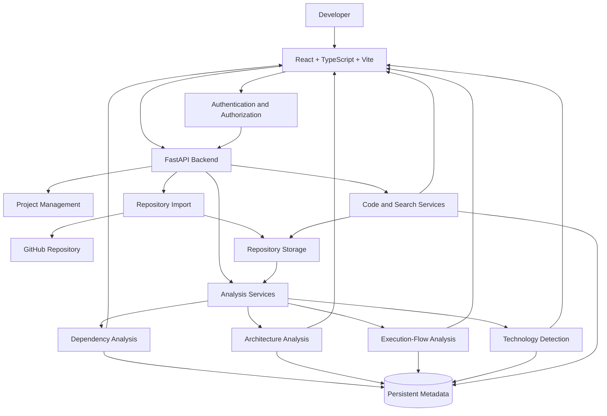
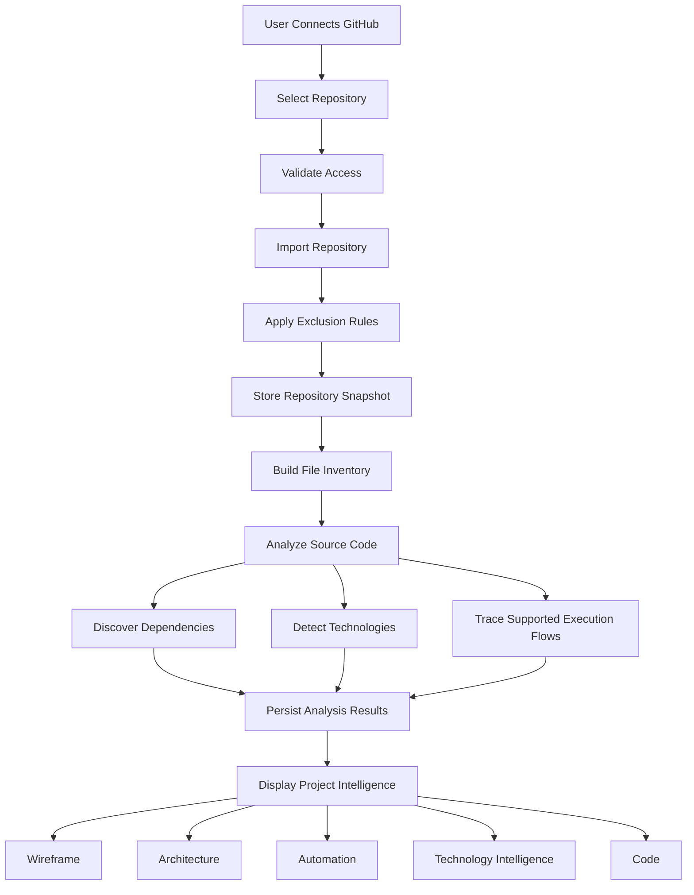

# ⚡ CodePilot — AI-Powered Codebase Intelligence Platform

> Understand your codebase. Visualize its architecture. Trace how it works.

CodePilot is an AI-powered software engineering intelligence platform designed to help developers understand complex repositories through interactive dependency visualization, architecture discovery, execution-flow analysis, technology intelligence, and source-code exploration.

Built with React, TypeScript, Vite, and FastAPI, CodePilot transforms imported GitHub repositories into navigable software intelligence, helping developers understand how files, functions, services, APIs, databases, and external integrations connect.

Instead of treating source code as disconnected files, CodePilot aims to build a unified, evidence-backed model of how an application is structured and how its components interact.

---

## 📖 Table of Contents

- [About the Project](#-about-the-project)
- [The Problem](#-the-problem)
- [Key Features](#-comprehensive-feature-breakdown)
- [System Architecture](#-system-architecture)
- [Repository Analysis Pipeline](#-repository-analysis-pipeline)
- [Technology Stack](#-complete-tech-stack--tools-used)
- [Project Architecture](#-project-architecture)
- [Core Analysis Concepts](#-core-analysis-concepts)
- [API Architecture](#-api-architecture)
- [Security and Authentication](#-security-and-authentication)
- [Getting Started](#-getting-started)
- [Environment Configuration](#-environment-configuration)
- [Development Workflow](#-development-workflow)
- [Performance and Scalability](#-performance-and-scalability)
- [Testing and Verification](#-testing-and-verification)
- [Engineering Principles](#-engineering-principles)
- [Future Roadmap](#-future-roadmap)
- [License](#-license)

---

## 🎯 About the Project

Modern software applications consist of interconnected components, frameworks, services, databases, APIs, and external dependencies. As a codebase grows, understanding how these elements interact becomes increasingly difficult.

CodePilot addresses this challenge by turning a repository into an interactive intelligence workspace.

Developers can import repositories, explore file dependencies, investigate application architecture, trace execution paths, understand technology usage, and navigate directly to the source code supporting an analysis.

The long-term vision is to create a unified intelligence layer that helps developers answer questions such as:
- How is this application structured?
- Which files depend on a particular component?
- What happens when a user performs a specific action?
- How does a request travel from the frontend to the backend and database?
- Where and why is a particular technology used?
- Which components might be affected by a code change?
- Where should I look when investigating an unfamiliar feature?

**Core philosophy:** CodePilot should explain software using evidence from the actual repository rather than relying on generic explanations or fabricated architectural relationships.

---

## 🚨 The Problem

Understanding an unfamiliar codebase is one of the most time-consuming parts of software development.

### Common challenges

1. **Complex dependencies**  
   A single file can be imported by dozens of components, services, and modules. Finding these relationships manually becomes difficult as the project grows.
2. **Invisible application architecture**  
   Source files do not automatically reveal the complete architecture. Developers must connect routes, middleware, business logic, database operations, and external services themselves.
3. **Difficult execution-flow tracing**  
   Following a user action through event handlers, API clients, backend routes, services, and data stores often requires opening many files.
4. **Technology overload**  
   A project may contain dozens of libraries and frameworks without clear documentation of where each technology is actually used.
5. **Missing or outdated documentation**  
   Traditional documentation often becomes disconnected from the implementation as code evolves.
6. **Slow developer onboarding**  
   New developers need to understand the directory structure, architectural decisions, business logic, and critical execution paths before making meaningful contributions.

### The CodePilot approach

CodePilot brings these activities into a unified workspace where repository structure, dependency relationships, architecture, execution flows, technology usage, and source files can be explored together.

---

## ✨ Comprehensive Feature Breakdown

### 1. 📊 Project Intelligence Dashboard

The dashboard provides the entry point for understanding an imported repository.

**Key capabilities:**
- **Project Overview** — Present repository information and available analysis results.
- **Technology Overview** — Display detected languages, frameworks, libraries, and other technologies.
- **Repository Structure** — Explore the organization of source files and folders.
- **Analysis Status** — Communicate import, indexing, and analysis progress.
- **Cross-Module Navigation** — Move between dependency visualization, architecture, execution flows, technology intelligence, and source code.
- **Repository Context** — Keep analysis associated with the relevant project and repository snapshot.

The dashboard reflects actual analysis results rather than displaying hardcoded statistics or invented repository metadata.

---

### 2. 🕸️ Wireframe — Dependency Intelligence

Wireframe focuses on the relationships between files and modules. Instead of manually navigating imports throughout a repository, developers can explore a visual representation of the dependency graph.

**Key capabilities:**
- **File Dependency Graph** — Visualize relationships between files.
- **Import Relationships** — Identify which files import other files.
- **Reverse Dependencies** — Discover which files depend on a selected file.
- **Circular Dependency Detection** — Identify dependency cycles when supported by the analysis.
- **Dependency Exploration** — Inspect neighboring files and connected modules.
- **File Search** — Locate files quickly within large repositories.
- **Relationship Inspection** — View available dependency metadata and source evidence.
- **Source Navigation** — Open relevant files in the Code tab.
- **Graph Filtering** — Reduce visual clutter by filtering file types and relationship categories.

#### Circular dependency visualization
For large repositories, a circular chord-style layout can group files by category while displaying their relationships:
- Pages
- Routes
- Components
- Actions and handlers
- Services
- Utilities
- APIs
- Configuration
- Other files

The visualization prioritizes readable relationships over displaying every possible connection simultaneously.

**Why it matters:** Wireframe helps developers understand the structure of a repository, identify tightly coupled modules, discover dependency chains, and investigate the potential impact of changes.

> **Engineering principle:** Dependency edges must come from actual import or reference analysis. Unresolved relationships must not be presented as confirmed dependencies.

---

### 3. 🏗️ Architecture — Application Structure Intelligence

Architecture helps developers understand the major components of an application and how they are connected. Rather than presenting only a list of technologies, it aims to reconstruct the application's actual structure from repository evidence.

**Key capabilities:**
- **Frontend Architecture** — Identify pages, components, state management, and API clients.
- **Backend Architecture** — Identify routes, middleware, services, and business logic.
- **Data Layer** — Discover database access, caching, persistence, and other data-related components.
- **External Integrations** — Identify references to external APIs and services.
- **Component Relationships** — Connect architectural components using available source evidence.
- **Request Lifecycle Visualization** — Represent supported request paths across application layers.
- **Source References** — Navigate from architectural components to relevant files.
- **Technology Connections** — Connect detected technologies to the parts of the application where they are used.

#### Example request lifecycle
```
User Action
    │
    ▼
Frontend Component
    │
    ▼
Event Handler
    │
    ▼
API Client / Transport
    │
    ▼
Backend Route
    │
    ▼
Middleware
    │
    ▼
Business Logic / Service
    │
    ▼
Database / Cache / External API
    │
    ▼
Response
    │
    ▼
Frontend State Update
    │
    ▼
UI Update
```

This diagram illustrates a common application pattern. Actual repositories may use different architectures, omit some stages, or introduce additional services. CodePilot displays only stages and connections supported by the analyzed project.

**Why it matters:** Architecture intelligence helps developers understand system boundaries, locate business logic, discover integration points, and investigate how an application is assembled.

---

### 4. ⚙️ Automation — Execution-Flow Intelligence

Automation focuses on understanding how the application actually executes operations. It is not limited to scheduled tasks or workflow automation. Its central purpose is to trace application behavior from an entry point through the relevant code and connected services.

**Key capabilities:**
- **Entry-Point Discovery** — Identify supported triggers such as UI events, API routes, handlers, and background jobs.
- **Execution-Flow Tracing** — Follow function calls and relationships through available source analysis.
- **Frontend-to-Backend Mapping** — Connect frontend actions to API requests and backend handlers when evidence supports the connection.
- **Service Tracing** — Explore business logic, utility calls, and service interactions.
- **Data Operations** — Identify database, cache, queue, and external-service interactions.
- **Background Flow Discovery** — Identify supported worker, queue, and asynchronous execution patterns.
- **Flow Inspection** — Open individual stages and navigate to their source files.
- **Step Navigation** — Explore supported execution paths step by step.
- **Flow Catalog** — Organize discovered flows into searchable groups.
- **Unresolved-Step Reporting** — Identify where tracing cannot establish the next relationship.

#### Example: Place Order flow
```
Customer clicks "Place Order"
    │
    ▼
Checkout Component
    │
    ▼
Submit Handler
    │
    ▼
Order API Client
    │
    ▼
Backend Order Route
    │
    ▼
Order Service
    │
    ▼
Database Transaction
    │
    ▼
Payment Provider
    │
    ▼
Order Confirmation
    │
    ▼
Updated UI State
```

#### Background processing
When supported by the repository, background flows can include:
- Queue producers and consumers.
- Worker processes.
- Asynchronous tasks.
- Scheduled jobs.
- Event-driven handlers.

These flows are connected to their initiating operations only when the relationship can be established.

**Why it matters:** Automation helps developers understand application behavior, follow request lifecycles, locate important processing stages, and investigate unfamiliar execution paths.

---

### 5. 🧠 Technology Intelligence

Technology Intelligence explains how technologies are used within a particular repository. A dependency appearing in `package.json` or `requirements.txt` does not necessarily prove that the application actively uses it. CodePilot connects technology information to implementation evidence whenever possible.

**Key capabilities:**
- **Technology Detection** — Identify languages, frameworks, libraries, databases, caches, and external integrations.
- **Project-Specific Explanations** — Explain the observable role of a technology in the analyzed application.
- **Usage Locations** — Identify files and modules associated with a technology.
- **Architecture Connections** — Connect technologies to relevant application components.
- **Execution-Flow Connections** — Show where technologies participate in supported application flows.
- **Dependency Context** — Use manifests and source references to distinguish declared dependencies from observed usage.
- **Evidence-Based Explanations** — Link explanations to relevant files, symbols, or source locations.
- **Confidence Indicators** — Distinguish confirmed findings from inferences and unresolved questions.

#### Example: Redis
| Field | Example |
| --- | --- |
| **Technology** | Redis |
| **General role** | In-memory data store |
| **Project usage** | Determined from repository evidence |
| **Related files** | Files identified by analysis |
| **Architecture connection** | Relevant services and data flows |
| **Evidence** | Source references, configuration, or dependency metadata |
| **Confidence** | Based on the available evidence |

The project-specific usage must be derived from the actual repository. CodePilot does not automatically claim Redis was selected for performance, caching, or queues without supporting evidence.

**Why it matters:** Technology Intelligence helps developers understand not only which tools a project contains, but where they participate in its architecture and behavior.

---

### 6. 💻 Code — Repository Browser

The Code tab provides direct access to the files stored for an imported repository. It acts as the source-reading interface connecting CodePilot's visualizations and explanations to the underlying implementation.

**Key capabilities:**
- **File Explorer** — Browse folders and files in a hierarchical tree.
- **Syntax Highlighting** — Display code using the appropriate language highlighting where supported.
- **Line Numbers** — Navigate and reference exact source locations.
- **Multiple Open Files** — Keep multiple files open in the viewer.
- **Breadcrumb Navigation** — Display the current repository-relative path.
- **Quick File Search** — Open files using <kbd>Ctrl</kbd>+<kbd>P</kbd>.
- **Repository-Wide Search** — Search stored code using <kbd>Ctrl</kbd>+<kbd>Shift</kbd>+<kbd>F</kbd>.
- **Code Outline** — Navigate supported functions, classes, and symbols.
- **Used By** — Inspect files that import the current file.
- **Import Navigation** — Open resolved import targets.
- **Cross-Module Navigation** — Jump to relevant files and lines from Wireframe, Architecture, Automation, and Technology Intelligence.
- **Copy Actions** — Copy code and repository-relative paths.
- **Excluded-File Visibility** — Display available exclusion metadata and reasons for files that were not stored.

#### Security and performance
The Code tab:
- Enforces project authorization before returning file content.
- Renders repository contents as text rather than executable HTML.
- Masks detected secrets before exposing content to clients.
- Avoids executing or modifying repository files.
- Loads large files and directory structures efficiently.
- Preserves file and line references across supported analysis modules.

---

## 🏗️ System Architecture

CodePilot separates its frontend experience from its backend analysis and persistence responsibilities.



### Architectural responsibilities

| Layer | Responsibility |
| --- | --- |
| **Frontend** | Project navigation, visualizations, code browsing, and user interactions |
| **Authentication** | User identity, sessions, and access control |
| **FastAPI backend** | API handling, business logic, validation, and authorization |
| **Repository import** | Retrieving and organizing repository content |
| **Analysis services** | Discovering dependencies, architecture, technologies, and execution relationships |
| **Persistent metadata** | Storing project information, analysis results, and relationships |
| **Repository storage** | Retaining stored source files and generated artifacts where configured |

---

## 🔄 Repository Analysis Pipeline

CodePilot's analysis process can be represented as a sequence of stages:



### Important design principles
- Repository import and background analysis are treated as separate stages.
- Stored files become available as soon as the import pipeline makes them available.
- Analysis results remain associated with the relevant repository snapshot.
- A failed analysis stage does not silently produce fabricated results.
- Unsupported relationships are reported as unresolved rather than guessed.

---

## 🛠️ Complete Tech Stack & Tools Used

### Frontend
| Technology | Purpose |
| --- | --- |
| [React](https://react.dev/) | Component-based user interface |
| [TypeScript](https://www.typescriptlang.org/) | Static typing for frontend application code |
| [Vite](https://vite.dev/) | Frontend development server and production build tooling |
| [Tailwind CSS](https://tailwindcss.com/) | Utility-first styling, where configured |
| [React Flow](https://reactflow.dev/) | Interactive node-and-edge visualizations, where used |
| [Three.js](https://threejs.org/) | Three-dimensional landing-page visuals, where implemented |
| [GitHub](https://github.com/) | Source repository hosting and repository integration |

### Backend
| Technology | Purpose |
| --- | --- |
| [Python](https://www.python.org/) | Backend programming language |
| [FastAPI](https://fastapi.tiangolo.com/) | HTTP API framework |
| [Uvicorn](https://www.uvicorn.org/) | ASGI server for running the FastAPI application |
| [Pydantic](https://docs.pydantic.dev/) | Data validation and request/response schemas |
| [SQLAlchemy](https://www.sqlalchemy.org/) | Database access and ORM, if configured in the current implementation |

### Potential Supporting Infrastructure
| Technology | Typical responsibility |
| --- | --- |
| [PostgreSQL](https://www.postgresql.org/) | Persistent relational metadata and analysis results |
| [Redis](https://redis.io/) | Caching and queue-related infrastructure |
| [Celery](https://docs.celeryq.dev/) | Background task processing |
| [Amazon S3](https://aws.amazon.com/s3/) | Persistent object storage for repository files and artifacts |
| [pgvector](https://github.com/pgvector/pgvector) | Vector similarity search when embedding-based retrieval is implemented |
| [Docker](https://www.docker.com/) | Reproducible deployment and containerized services |

---

## 📂 Project Architecture

The backend structure previously established for CodePilot follows a modular FastAPI organization:

```
CodePilot/
│
├── frontend/             # React + TypeScript + Vite application
│   ├── public/           # Static public assets
│   ├── src/
│   │   ├── components/   # Reusable UI components
│   │   ├── pages/        # Project and feature views
│   │   ├── services/     # API client and frontend services
│   │   ├── hooks/        # Reusable React hooks
│   │   ├── utils/        # Shared utilities
│   │   ├── App.tsx       # Root application
│   │   └── main.tsx      # Frontend entry point
│   ├── package.json
│   └── vite.config.ts
│
├── backend/
│   ├── app/
│   │   ├── models/       # Database models
│   │   ├── routers/      # API route definitions
│   │   ├── schemas/      # Request and response schemas
│   │   ├── services/     # Business logic and analysis services
│   │   ├── config.py     # Application configuration
│   │   └── main.py       # FastAPI application entry point
│   ├── Dockerfile
│   ├── docker-compose.yml
│   └── requirements.txt
│
├── .gitignore
├── .env.example
└── README.md
```

> **Important:** This is a conceptual directory structure based on the known project organization. Reconcile it with the actual repository before using it as an exact file inventory.

---

## 🧩 Core Analysis Concepts

### 1. Repository Snapshots
A repository snapshot represents the version of a project being analyzed. Associating analysis results with a snapshot helps prevent relationships from one repository version being mixed with files from another.

A snapshot can be associated with:
- Repository identity.
- Commit or revision metadata.
- Stored file inventory.
- Dependency analysis.
- Architecture analysis.
- Technology detection.
- Execution-flow analysis.

### 2. Evidence-Based Relationships
CodePilot distinguishes confirmed relationships from inferences:

| Confidence | Meaning |
| --- | --- |
| **Confirmed** | Directly supported by available source or structural evidence |
| **Strong inference** | Supported by multiple related pieces of evidence |
| **Possible** | Plausible, but not sufficiently established |
| **Unknown** | The available evidence does not establish the relationship |

For example, an explicit import statement can establish a file dependency. A connection between a frontend button and a backend database write may require tracing several additional steps. Unresolved relationships remain visible as unresolved rather than being represented as confirmed facts.

### 3. Cross-Module Intelligence
The primary modules share consistent repository and source references:

```
                  Repository Snapshot
                           │
                Shared Analysis Metadata
           ┌───────────────┴───────────────┐
           │                               │
       Wireframe                      Architecture
           │                               │
           └───────────────┬───────────────┘
                           │
                       Automation
                           │
                 Technology Intelligence
                           │
                         Code
```

This design allows a developer to move from a visual relationship to its architectural role, execution context, technology usage, and source implementation.

---

## 🔌 API Architecture

CodePilot uses FastAPI for its backend API layer. The backend is responsible for validating requests, enforcing authorization, interacting with persistent storage, and returning project-related information.

### Expected API responsibility areas

| Area | Responsibility |
| --- | --- |
| **Authentication** | Login callbacks, session handling, and account identity |
| **Projects** | Project creation, listing, configuration, and deletion |
| **Repository integration** | Repository selection, import, and synchronization |
| **File access** | Authorized file listing, content retrieval, and search |
| **Wireframe** | Dependency graph and relationship queries |
| **Architecture** | Architectural components and connections |
| **Automation** | Execution-flow discovery and inspection |
| **Technology Intelligence** | Technology metadata and evidence-backed usage information |
| **Background jobs** | Import and analysis status, where asynchronous processing is configured |

### API documentation
FastAPI can expose interactive API documentation when the corresponding documentation endpoints are enabled. During local development, check the backend's configured OpenAPI documentation route, commonly `/docs`.

---

## 🔐 Security and Authentication

CodePilot handles private repositories, source code, project metadata, and user-specific information. Security is therefore a core architectural requirement.

### Authentication
- Support configured Google and GitHub login flows.
- Validate authentication results on the backend.
- Use secure session or token handling appropriate to the implementation.
- Prevent unsafe account linking and unauthorized session reuse.

### Authorization
- Enforce project and workspace access on the backend.
- Verify membership and permissions for every protected resource.
- Prevent users from accessing another user's repositories, files, analysis results, and search responses.
- Apply consistent authorization to background jobs and storage operations.

### Credential Management
- Keep OAuth client secrets, signing keys, database credentials, and private API keys out of frontend bundles.
- Store production secrets in environment variables or a managed secret store.
- Never commit populated `.env` files.
- Rotate credentials that may have been exposed.

### Repository Security
- Treat imported repositories as untrusted input.
- Validate file paths and protect against path traversal.
- Render code as text rather than executable HTML.
- Mask detected secrets before exposing source content.
- Apply file-size and resource limits to protect import and analysis workers.

### Data Persistence
- User accounts, project metadata, and repository references should be stored in durable backend-managed storage.
- Repository contents and generated artifacts should use storage appropriate to their size, durability, and access requirements.
- Data persistence must be tested across application restarts, redeployments, and worker failures.

---

## 🚀 Getting Started

### Prerequisites
Before running CodePilot locally, verify that you have:
- [Git](https://git-scm.com/) installed.
- [Node.js](https://nodejs.org/) and npm installed.
- [Python](https://www.python.org/) installed at a version supported by the project's dependencies.
- Access to the required GitHub OAuth configuration.
- Google OAuth credentials if Google login is enabled.
- A configured production-compatible or development database if required.

### 1. Clone the Repository
```bash
git clone https://github.com/akhilshah179/CodePilot.git
cd CodePilot
```

### 2. Configure Environment Variables
Create the appropriate local environment files based on the actual frontend and backend configuration:

```bash
# Windows PowerShell
Get-Content .env.example

# macOS / Linux
cat .env.example
```

### 3. Install Frontend Dependencies
```bash
# If frontend is in frontend/:
cd frontend && npm install && cd ..

# Or if at workspace root:
npm install
```

### 4. Install Backend Dependencies
```bash
cd backend
python -m venv .venv

# Activate the environment:
# Windows PowerShell:
.venv\Scripts\Activate.ps1
# macOS / Linux:
source .venv/bin/activate

pip install -r requirements.txt
cd ..
```

### 5. Start the Backend
```bash
cd backend
uvicorn app.main:app --reload
```

### 6. Start the Frontend
```bash
# In frontend directory or root:
npm run dev
```

### 7. Verify the Application
Confirm that:
- The frontend starts successfully.
- The backend starts successfully.
- Required database connections work.
- Authentication callbacks are correctly configured.
- Repository imports complete.
- Stored files can be retrieved.
- Analysis results are associated with the correct project.
- Protected project data cannot be accessed by unauthorized users.

---

## ⚙️ Environment Configuration

| Configuration | Purpose |
| --- | --- |
| **Database connection** | Connect the backend to persistent application metadata |
| **Google OAuth client ID** | Identify the Google OAuth application |
| **Google OAuth client secret** | Authenticate backend-side OAuth operations |
| **GitHub OAuth client ID** | Identify the GitHub OAuth application |
| **GitHub OAuth client secret** | Authenticate backend-side OAuth operations |
| **Frontend origin** | Configure permitted browser origins |
| **Backend signing key** | Sign or validate application credentials, if applicable |
| **Repository storage configuration** | Configure persistent file and artifact storage |
| **Redis connection** | Configure caching or queues, if used |
| **AI provider key** | Configure AI features, if integrated |

### Example placeholder format:
```env
# Example only — use the variable names required by your codebase.
DATABASE_URL=your_database_connection_string
GOOGLE_CLIENT_ID=your_google_client_id
GOOGLE_CLIENT_SECRET=your_google_client_secret
GITHUB_CLIENT_ID=your_github_client_id
GITHUB_CLIENT_SECRET=your_github_client_secret
FRONTEND_URL=http://localhost:5175
```

### Production configuration
Before deployment:
- Configure the correct production OAuth callback URLs.
- Restrict CORS to the intended frontend origins.
- Use HTTPS for public traffic.
- Configure persistent storage.
- Run required database migrations.
- Ensure background workers are deployed if the application depends on them.
- Disable debug features that should not be public.
- Verify backup and recovery procedures.

---

## 📈 Performance and Scalability

CodePilot must account for repositories that vary substantially in size and complexity.

### Repository Processing
- Avoid loading entire repositories into frontend memory.
- Apply file exclusions and resource limits during import.
- Separate repository import from longer-running analysis tasks.
- Make import and analysis operations safe to retry.
- Associate results with the correct repository snapshot.

### Graph Performance
- Avoid rendering unnecessary dependency edges.
- Support filtering and incremental graph exploration.
- Consider graph layout computation outside the main UI thread for large repositories.
- Keep node identities stable where possible.
- Provide useful loading states for expensive analysis.

### Code Browsing
- Load file contents on demand.
- Virtualize large file trees and source lines.
- Index repository content when required for efficient search.
- Respect authorization when retrieving cached content.
- Invalidate stale results when repository snapshots change.

### Backend Operations
Where appropriate, use:
- Database indexing and pagination.
- Bounded concurrency.
- Background workers.
- Request timeouts and resource limits.
- Caching with correct project and snapshot boundaries.
- Structured logging and monitoring.

---

## 🧪 Testing and Verification

A reliable codebase intelligence platform needs tests for both software correctness and the accuracy of its analysis.

### Functional Verification
- Repository import and file persistence.
- Dependency graph generation.
- Architecture relationships.
- Execution-flow tracing.
- Technology detection.
- Code browsing and syntax highlighting.
- Repository-wide search.
- File and line navigation between modules.

### Security Verification
- Unauthorized API requests are rejected.
- Users cannot access other users' project data.
- OAuth callbacks are validated.
- Secrets are not exposed in frontend bundles.
- Malicious repository contents are rendered safely.
- File paths cannot escape the intended repository boundary.
- Background jobs preserve tenant isolation.

### Reliability Verification
- Failed imports expose useful error messages.
- Retry operations do not create inconsistent project state.
- Stored data survives application restarts and redeployments.
- Large repositories remain usable.
- Missing or unsupported analysis data is handled explicitly.

### Analysis Accuracy
Verify that:
- Import relationships correspond to actual source evidence.
- Circular dependencies represent genuine cycles.
- Execution-flow connections are not invented.
- Technology usage claims are supported by available evidence.
- Unknown relationships remain marked as unresolved.
- Source references point to the correct repository snapshot and line.

---

## 💡 Engineering Principles

1. **Evidence Before Explanation**  
   Important relationships and explanations should be traceable to source code, manifests, configuration, or other available evidence.
2. **Shared Intelligence**  
   Wireframe, Architecture, Automation, Technology Intelligence, and Code should use consistent project identifiers, file references, and repository snapshots.
3. **Repository-Agnostic Analysis**  
   CodePilot should analyze imported repositories rather than depending on hardcoded assumptions about one application or technology stack.
4. **Honest Uncertainty**  
   When the source does not establish a relationship, CodePilot should identify the uncertainty rather than fabricate a connection.
5. **Security by Design**  
   Authentication, authorization, tenant isolation, secret protection, and secure repository processing must be enforced throughout the application.
6. **Persistent Project Context**  
   Users should be able to return to their stored projects and access persisted data without relying on temporary browser state.
7. **Usable Visualizations**  
   Visualizations should help developers answer specific questions, not merely display large quantities of nodes and connections.

---

## 🛣️ Future Roadmap

### Phase 1 — Repository Intelligence
- Reliable repository imports and snapshots.
- Accurate dependency analysis.
- Architecture discovery.
- Evidence-backed technology detection.
- Source-code browsing and search.

### Phase 2 — Deeper Execution Intelligence
- More complete execution-flow tracing.
- Better asynchronous and background-job discovery.
- Improved cross-module navigation.
- More efficient analysis of large repositories.

### Phase 3 — AI Codebase Copilot
- Natural-language questions about a repository.
- Source-grounded answers with file and line references.
- Contextual explanations of unfamiliar modules.
- Search across code, architecture, and execution relationships.

### Phase 4 — Change Impact Analysis
- Identify files and features potentially affected by a change.
- Trace dependency chains.
- Connect changes to relevant tests and execution flows.
- Generate evidence-backed risk reports.

### Phase 5 — Engineering Reliability
- Codebase health analysis.
- Security and dependency-risk intelligence.
- Pull-request review using repository context.
- Safer, test-verified code-change assistance.

---

## 📄 License

Specify the project's actual license here before publishing or distributing the repository.

---

<p align="center">
<strong>CodePilot — Making complex codebases easier to understand.</strong><br />
Built for developers who want to understand not just what code exists, but how the entire system works.
</p>
