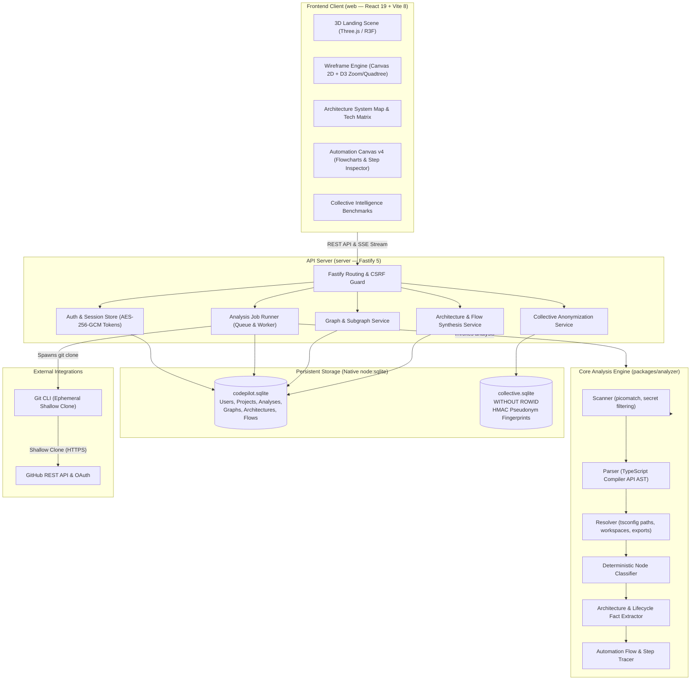
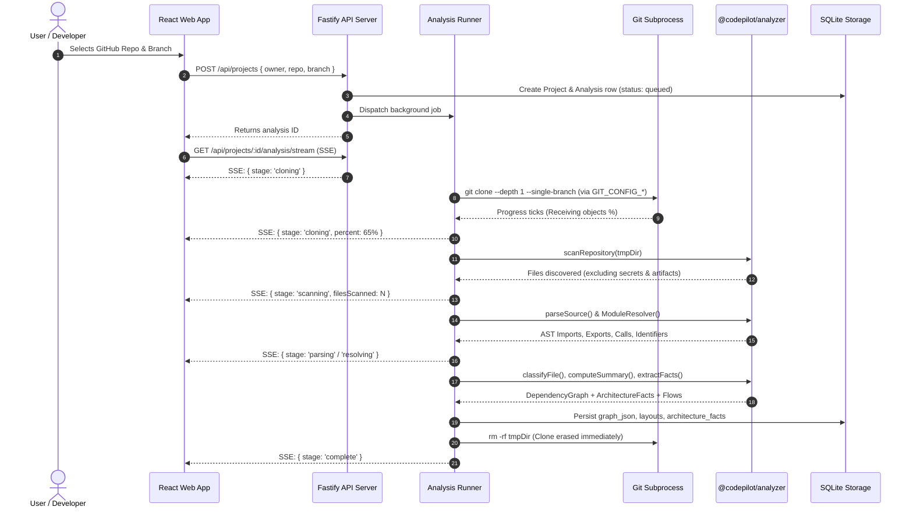
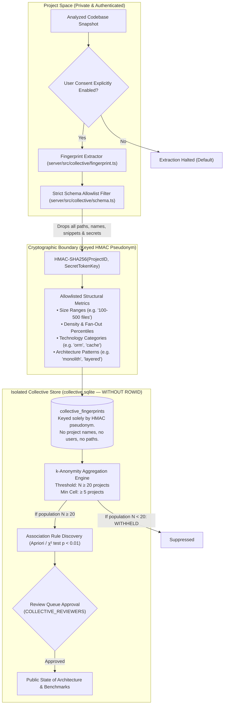
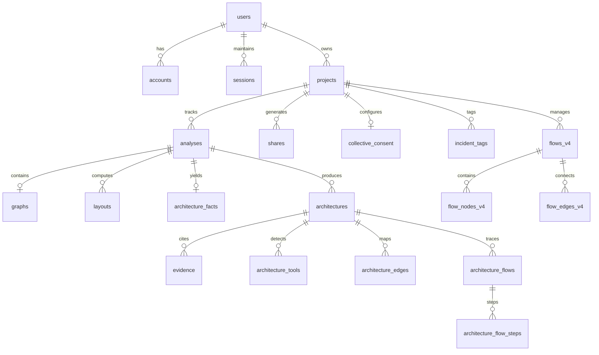

# CodePilot

<div align="center">

**Living, evidence-backed codebase intelligence, interactive dependency wireframes, automated execution-flow tracing, and zero-knowledge architectural benchmarking.**

[](https://nodejs.org/)
[](https://fastify.dev/)
[](https://react.dev/)
[](https://www.typescriptlang.org/)
[](https://vitejs.dev/)
[](https://nodejs.org/api/sqlite.html)
[](https://threejs.org/)
[](https://vitest.dev/)
[](https://github.com/akhilshah179/CodePilot/actions/workflows/ci.yml)
[](LICENSE)

[Overview](#project-overview) • [Architecture](#system-architecture) • [Wireframe Intelligence](#wireframe-and-dependency-intelligence) • [Automation Engine](#automation-engine) • [Technology Intelligence](#technology-intelligence) • [Collective Intelligence](#collective-intelligence) • [API Reference](#api-architecture) • [Local Setup](#getting-started)

</div>

---

## Table of Contents

- [Project Overview](#project-overview)
  - [The Problem](#the-problem)
  - [The CodePilot Solution](#the-codepilot-solution)
  - [Core Principles](#core-principles)
- [System Architecture](#system-architecture)
  - [High-Level Component Architecture](#high-level-component-architecture)
  - [Repository Ingestion & Analysis Pipeline](#repository-ingestion--analysis-pipeline)
  - [Automation Flow Tracing Pipeline](#automation-flow-tracing-pipeline)
  - [Collective Intelligence Privacy Pipeline](#collective-intelligence-privacy-pipeline)
- [Core Capabilities](#core-capabilities)
  - [1. Wireframe & Dependency Intelligence](#wireframe-and-dependency-intelligence)
  - [2. System Architecture Map](#system-architecture-map)
  - [3. Automation Engine (Execution Flow Tracing)](#automation-engine)
  - [4. Technology Intelligence](#technology-intelligence)
  - [5. Collective Intelligence (Zero-Knowledge Benchmarks)](#collective-intelligence)
  - [6. Interactive 3D Living Scene](#interactive-3d-living-scene)
- [Database Architecture](#database-architecture)
  - [Primary Database (`codepilot.sqlite`)](#primary-database-codepilotsqlite)
  - [Collective Dataset Database (`collective.sqlite`)](#collective-dataset-database-collectivesqlite)
- [API Architecture & Endpoint Reference](#api-architecture)
- [Technology Stack](#technology-stack)
- [Repository Directory Structure](#repository-directory-structure)
- [Getting Started & Local Setup](#getting-started)
  - [Prerequisites](#prerequisites)
  - [Installation Steps](#installation-steps)
  - [Environment Configuration](#environment-configuration)
  - [Running Development Servers](#running-development-servers)
  - [Production Build & Deployment](#production-build--deployment)
- [Verification & Testing](#verification--testing)
- [Security Architecture & Threat Model](#security-architecture--threat-model)
- [Engineering Highlights & Design Decisions](#engineering-highlights--design-decisions)
- [Known Limitations & Roadmap](#known-limitations--roadmap)
- [Authors & Repository](#authors--repository)

---

## Project Overview

### The Problem

Modern software repositories grow rapidly into monolithic webs of interconnected dependencies, opaque framework abstractions, and undocumented runtime lifecycles. Engineering teams consistently suffer from:

1. **Cognitive Overload during Onboarding:** New engineers spend weeks tracing call graphs across hundreds of source files, attempting to map mental models of how user interactions translate to backend actions.
2. **Rotting Architecture Diagrams:** Static design documents and wiki diagrams become obsolete within days of creation, diverging dangerously from the actual committed source code.
3. **Hidden Architectural Debt & Fragility:** Circular imports (SCCs), uncontrolled module fan-in/fan-out, architectural boundary leaks, and orphan files remain invisible until they cause circular initialization crashes or deployment failures.
4. **Hallucinated or Fluffy Documentation:** Conventional AI tools frequently generate plausible-sounding explanations of project structures that have no basis in reality, citing imaginary files or misattributing framework purposes.

### The CodePilot Solution

**CodePilot** connects to any GitHub repository or local codebase and automatically constructs a deterministic, evidence-backed knowledge graph of every file, symbol, import, route, middleware, handler, technology, and execution flow.

Unlike generic code visualization tools, CodePilot enforces **zero decorative data**:
- **Every edge and node originates directly from source AST parsing and configuration analysis.**
- **Every claim is pinned to an exact file path, line number, and redacted code snippet.**
- **Confidence ratings are mathematically verifiable** (`confirmed`, `strong inference`, `possible`, or `unknown`).
- **Unresolved targets are marked explicitly** rather than guessed, preventing false assumptions.

### Core Principles

```
                  ┌─────────────────────────────────────────┐
                  │           CODEPILOT PRINCIPLES          │
                  └─────────────────────────────────────────┘
                                       │
     ┌───────────────────┬─────────────┴───────┬───────────────────┐
     ▼                   ▼                     ▼                   ▼
┌───────────────┐ ┌───────────────┐  ┌───────────────────┐ ┌───────────────┐
│ Real Evidence │ │ Determinism   │  │ Zero Hallucination│ │ Total Privacy │
│ Every node &  │ │ Stable layouts│  │ When a runtime    │ │ Ephemeral git │
│ edge carries  │ │ ensure files  │  │ target is dynamic,│ │ clones; strict│
│ file, line &  │ │ never jump    │  │ it is labeled as  │ │ k-anonymity   │
│ snippet refs  │ │ during filter │  │ "Unknown Target"  │ │ allowlists    │
└───────────────┘ └───────────────┘  └───────────────────┘ └───────────────┘
```

---

## System Architecture

CodePilot is structured as an npm workspaces monorepo separating static AST analysis, Fastify API orchestration, and high-performance WebGL/Canvas visualization.

```
┌────────────────────────────────────────────────────────────────────────┐
│                        CODEPILOT MONOREPO                              │
│                                                                        │
│   ┌────────────────────┐   ┌─────────────────┐   ┌─────────────────┐   │
│   │ packages/analyzer  │   │     server      │   │       web       │   │
│   │ Zero-dependency AST│   │ Fastify 5 API   │   │ React 19 + Vite │   │
│   │ parser & compiler  │   │ Node:sqlite DB  │   │ 2D Canvas + D3  │   │
│   │ pipeline           │   │ OAuth & Jobs    │   │ Three.js / R3F  │   │
│   └────────────────────┘   └─────────────────┘   └─────────────────┘   │
└────────────────────────────────────────────────────────────────────────┘
```

### High-Level Component Architecture



---

### Repository Ingestion & Analysis Pipeline

When a repository is imported, CodePilot executes a multi-phase analysis pipeline. The remote codebase is never permanently stored on disk; it is cloned shallowly, parsed into structural facts, and discarded.



---

### Automation Flow Tracing Pipeline

The **Automation Engine** maps out end-to-end user actions and system triggers, following execution threads through every architectural tier.

```mermaid
flowchart LR
    subgraph Trigger["1. User Action / Trigger"]
        T1["Button Click (UI Event)"]
        T2["Page Route Load"]
        T3["Scheduled / Event Trigger"]
    end

    subgraph Frontend["2. Client Layer"]
        F1["Component Handler"]
        F2["API Client / fetch wrapper"]
    end

    subgraph Transport["3. Transport Layer"]
        TR1["REST Endpoint (POST /api/...)"]
        TR2["Server-Sent Events (SSE)"]
        TR3["WebSocket Event"]
    end

    subgraph Backend["4. Server Routing"]
        B1["Route Declaration"]
        B2["Middleware Chain (Hooks, CORS, Auth)"]
        B3["Route Controller Handler"]
    end

    subgraph Services["5. Service & Domain"]
        S1["Domain Service Function"]
        S2["Validation / Business Rules"]
    end

    subgraph Data["6. Data & Integrations"]
        D1[("Database ORM / SQL Query")]
        D2[("Redis Cache Read/Write")]
        D3["Async Message Queue (BullMQ/Celery)"]
        D4["External API / SaaS Webhook"]
    end

    subgraph Response["7. Client Response & State"]
        R1["Response Payload Serialization"]
        R2["UI State Mutation / Navigation"]
    end

    Trigger --> Frontend --> Transport --> Backend --> Services --> Data
    Services --> Response
    Backend --> Response
    Data -.->|"Async Branch (Non-blocking)"| D3
```



---

### Collective Intelligence Privacy Pipeline

CodePilot's **Collective Intelligence** enables cross-project architectural pattern discovery without exposing proprietary code, symbols, or infrastructure coordinates.



---

## Core Capabilities

### Wireframe and Dependency Intelligence

The Wireframe view answers: **What is connected to what?**

It operates directly on the resolved dependency graph, offering three distinct projections:

#### 1. Ring Mode (Radial Bundled Dependency Graph)
- **Deterministic Placement:** Every file occupies a permanent radial slot categorized into fixed arcs:
  `Pages` • `Routes` • `Components` • `Actions` • `Services` • `Utilities` • `APIs` • `Configuration` • `Other`.
  Files are sorted by directory then filename, ensuring a file never jumps or shifts during filtering, searching, or zooming.
- **Hierarchical Edge Bundling:** Rather than drawing chaotic direct chords across the circle, dependency threads are bundled hierarchically through category and directory control points, turning hairballs into legible architectural highways.
- **Semantic Zooming:** Zoom level smoothly transitions from discrete tick markers to file names, and further to full directory paths with node type badges.
- **Precision Focus & Triage:**
  - Hovering a node highlights its direct dependencies in **Red** (outbound imports) and dependents in **Blue** (inbound imported-by), while dimming unrelated threads to ~8% opacity.
  - Clicking locks the inspector and activates transitive depth exploration (1 to 3 hops).
  - Double-clicking isolates the node and its immediate neighborhood.
  - Category band clicks focus an entire architectural subsystem.
- **Extreme Performance:** Built on Canvas 2D with D3 Quadtree spatial hit-testing. Tested at 1,500 files and 6,000 dependencies in Chrome at 2× pixel ratio: first draw in 32 ms, redraw in 9–15 ms, and under 1 ms when a node is focused. Nothing redraws when idle.

#### 2. Layered Mode
Visualizes dependencies as top-to-bottom architectural strata:
$$\text{Routes / Pages} \longrightarrow \text{Components} \longrightarrow \text{Actions} \longrightarrow \text{Services} \longrightarrow \text{Utilities} \longrightarrow \text{External Packages}$$
Highlights architectural boundary violations where low-level utilities improperly import high-level domain handlers.

#### 3. Summary Mode
Provides instant topological health metrics:
- **Graph Totals:** Total nodes, edges, external package references, and analyzer parse coverage.
- **Category Dependency Matrix:** A cross-tabulation of calls between architectural layers. Clicking any cell immediately isolates those specific threads on the Ring.
- **Hub Analysis:** Identifies high-risk bottleneck files with disproportionate fan-in (danger of breaking changes) or fan-out (excessive coupling).
- **Import Cycle Detection:** Evaluates cyclic dependencies using **Tarjan's Strongly Connected Components (SCC)** algorithm, detailing each cycle hop with exact line numbers.
- **Orphan Detection:** Surfaces unreferenced files that have zero incoming and zero outgoing dependencies within the project.

---

### System Architecture Map

The System Map answers: **How does the system work as an application?**

It categorizes application components into vertical and horizontal swimlanes based on static facts:
- **Client:** Frontend web apps, entry point bundles, UI views.
- **Transport / API:** Communication protocols and interfaces (REST endpoints, Server-Sent Events, WebSockets, tRPC).
- **Backend Routing:** Fastify/Express/Next.js route declarations and controllers.
- **Middleware Chain:** Global and scoped middleware hooks executed in exact registration order (CORS, authentication guards, body parsers, logging).
- **Services:** Pure business logic modules and domain handlers.
- **Data & Cache:** Databases (PostgreSQL, SQLite, MySQL, MongoDB), ORMs (Prisma, Drizzle, TypeORM), and caching tiers (Redis, Memcached).
- **Async Workers & Queues:** Background job dispatchers and queue workers (BullMQ, Celery, Kafka, RabbitMQ).
- **External Services:** Third-party APIs (Stripe, GitHub API, AWS S3, SendGrid).

> [!NOTE]
> When a network call or service destination is computed dynamically at runtime (such as URLs assembled from string interpolation or dynamic service locators), CodePilot routes the connection to an explicit **"Unknown Target"** node rather than guessing.

---

### Automation Engine

The Automation Engine answers: **How do application flows actually execute from trigger to response?**

#### Automation Engine v4 Flowcharts
CodePilot automatically synthesizes flowcharts of the project's primary user and system journeys across 9 standardized stage columns:

$$\text{User} \longrightarrow \text{Frontend} \longrightarrow \text{Transport} \longrightarrow \text{Backend} \longrightarrow \text{Services} \longrightarrow \text{Tools} \longrightarrow \text{Data} \longrightarrow \text{External} \longrightarrow \text{Response}$$

```
┌──────┐   ┌──────────┐   ┌───────────┐   ┌─────────┐   ┌──────────┐   ┌──────┐   ┌──────────┐
│ User │──▶│ Frontend │──▶│ Transport │──▶│ Backend │──▶│ Services │──▶│ Data │──▶│ Response │
│Action│   │Component │   │REST / SSE │   │ Handler │   │ Function │   │Store │   │ State UI │
└──────┘   └──────────┘   └───────────┘   └─────────┘   └──────────┘   └──────┘   └──────────┘
                                                               │
                                                               └──▶ [Async Worker Queue]
```

#### Step Inspector & Blast Radius
Selecting any step in an automated flow reveals:
- **Execution Metadata:** Exact file path, line number, caller, callee, declared HTTP method, and route signature.
- **Input & Output Signatures:** Function call arguments, returned payload shapes, and response models.
- **Execution Mode:** Synchronous vs. Asynchronous (`ASYNC — does not block the user response`).
- **Code Evidence:** Verifiable source snippet directly from the scanned file.
- **Blast Radius Analysis:** Instant 1-hop, 2-hop, and 3-hop downstream dependency cascade showing which files would be impacted if this step's contract changes.

#### Flow Customization & Library
- **Searchable Flow Library:** Filter flows by trigger type, route, component, file, category, or specific technology (e.g. clicking `Redis` lists every flow touching Redis).
- **Customization Persistence:** Users can rename flows or swap a synthesized main flow with another candidate flow via `POST /api/projects/:id/automation/flows/:flowId/replace`.

---

### Technology Intelligence

Technology Intelligence answers: **What technologies power this repository, and why is each one used here?**

Generic analyzers merely list dependencies found in `package.json`. CodePilot determines **project-specific purpose**:

| Technology | Detected Version | Architecture Role | Project-Specific Purpose | Verifiable Evidence | Confidence |
|---|---|---|---|---|---|
| **Fastify** | `^5.12.5` | Backend Framework | Core HTTP API server, plugin registration, and lifecycle routing | `server/src/app.ts:2` | `confirmed` |
| **node:sqlite** | Native Node.js | Database Engine | Embedded transactional storage for projects, graphs, and layouts | `server/src/db.ts:1` | `confirmed` |
| **React** | `^19.3.0` | Frontend UI | Single-page application rendering, hooks, and context management | `web/src/main.tsx:1` | `confirmed` |
| **Three.js** | `^0.186.1` | 3D Visualization | Real-time WebGL rendering of the 3D living codebase landing scene | `web/src/features/landing3d/LivingScene.tsx:6` | `confirmed` |
| **d3-zoom** | `^3.0.0` | Graph Interaction | Smooth panning, zooming, and quadtree spatial partitioning on 2D canvas | `web/src/graph/GraphCanvas.tsx:18` | `confirmed` |
| **@resvg/resvg-js**| `^2.6.2` | Export Pipeline | High-fidelity server-side SVG to PNG rasterization | `server/src/routes/projects.ts:1` | `confirmed` |

#### The Refusal to Hallucinate
If a package is present in `package.json` but the codebase never calls its APIs or imports its modules, CodePilot classifies its role as unused or reports:
> *"Purpose could not be confidently determined from the available source."*

General descriptions are always labeled as generic catalog information and never confused with verified repository evidence.

---

### Collective Intelligence

Collective Intelligence answers: **How does this architecture compare against anonymized real-world systems?**

- **Strictly Opt-In:** Disabled by default. Enabled only per-project by the project owner via `POST /api/projects/:id/collective-intelligence/consent`. All consent decisions are stored in an immutable audit log (`consent_log`).
- **Structural Allowlist Validation:** Before writing any fingerprint, the payload is validated against an enumerated schema (`server/src/collective/schema.ts`).
  - **Forbidden:** File paths, filenames, symbol names, comments, commit messages, repository names, user logins, environment variables, secrets, IP addresses, or exact file counts.
  - **Permitted:** Coarse size ranges (e.g., `100_to_500_files`), topology buckets (density, 90th-percentile fan-out), architectural patterns (e.g. `layered`, `monolith`), and technology category relationships (e.g. `frontend -> rest_api -> orm`).
- **Cryptographic Isolation:** Fingerprints are stored in an independent database (`collective.sqlite`) with tables created `WITHOUT ROWID`. Records are keyed by an HMAC pseudonym computed using the server's private secret key:
  $$\text{Pseudonym} = \text{HMAC-SHA256}(\text{ProjectID}, \text{TOKEN\_ENCRYPTION\_KEY})$$
  Even a raw dump of `collective.sqlite` cannot be joined against `codepilot.sqlite`.
- **k-Anonymity ($N \ge 20$):** No benchmark metric or population insight is ever served unless at least 20 distinct projects contribute to that population bucket. Individual cells with fewer than 5 contributing projects are masked.
- **Immediate Revocation:** If consent is revoked, the project's fingerprints are deactivated immediately, excluded from all cached aggregates, and subsequent aggregations are recomputed from scratch.

---

### Interactive 3D Living Scene

The landing page features a real-time, interactive 3D WebGL scene (`web/src/features/landing3d/`) rendering CodePilot's analysis of its own source code:
- **True Repository Geometry:** Every point is a real source file, exported symbol, or external package. Every line is a real import or detected architectural relationship.
- **Narrative Chapter Morphing:** As the user scrolls, nodes smoothly interpolate between 6 chapter layouts:
  1. *Discover:* GitHub clone → File tree → Ingestion.
  2. *Understand:* Files grouped by directory around applications.
  3. *Map:* Layered architecture swimlanes with REST / SQL connections.
  4. *Trace:* End-to-end request flow animation with moving data packets.
  5. *Explain:* Technologies positioned in orbit with live evidence tooltips.
  6. *Verify:* Source call-site and route handlers side by side.
- **Main-Thread Optimization:** Point and line coordinate buffers are mutated directly on GPU buffers without triggering React re-renders. Renders at ~1.2 ms per frame on desktop GPUs. Falls back to a lightweight 2D static illustration on mobile devices or hardware reporting $\le 2$ CPU cores or $\le 2\text{ GB}$ RAM.

---

## Database Architecture

CodePilot utilizes native **Node.js SQLite (`node:sqlite`)**, eliminating external database dependencies while providing atomic ACID transactions and WAL mode concurrency.

```
┌─────────────────────────────────┐       ┌─────────────────────────────────┐
│         codepilot.sqlite        │       │        collective.sqlite        │
│   (Application & Project Data)  │       │  (Isolated Zero-Knowledge DB)   │
│                                 │       │                                 │
│  users ─────── accounts         │       │  collective_fingerprints        │
│    │             │              │       │  pattern_outcomes               │
│  sessions    oauth_states       │       │  aggregate_statistics           │
│    │                            │       │  discovered_patterns            │
│  projects ──── analyses         │       │                                 │
│    │             ├── graphs     │       │  * Tables created WITHOUT ROWID │
│    ├── shares    ├── layouts    │       │  * Keyed by HMAC pseudonyms     │
│    └── consent   └── arch_facts │       │  * Zero project or user foreign │
│                      ├── archs  │       │    keys                         │
│                      └── flows  │       └─────────────────────────────────┘
└─────────────────────────────────┘
```

### Primary Database (`codepilot.sqlite`)

Manages users, authentication, projects, analysis snapshots, dependency graphs, and architecture flows.



#### Core Table Definitions

| Table Name | Primary Key | Description |
|---|---|---|
| `users` | `id` | User identity records (ID, name, email, avatar URL). |
| `accounts` | `id` | Linked OAuth accounts (GitHub, Google) with encrypted access tokens (`token_enc`). |
| `sessions` | `id_hash` | Active user sessions stored as SHA-256 hashes of the session token. |
| `projects` | `id` | Monitored repositories (`owner`, `repo`, `branch`, `default_branch`, `is_private`). |
| `analyses` | `id` | Analysis runs with status (`queued`, `running`, `complete`, `failed`) and counters. |
| `graphs` | `analysis_id` | Full dependency graph payload stored as serialized JSON. |
| `layouts` | `(analysis_id, layout)` | Cached 2D node coordinates (`force`, `circular`, `layered`, `type`, `directory`). |
| `architecture_facts` | `analysis_id` | Raw AST facts, manifests, and infrastructure signals extracted during checkout. |
| `architectures` | `id` | Detected architecture snapshot cached by `(project_id, cache_key, detector_version)`. |
| `evidence` | `(architecture_id, id)` | Verifiable source snippets with file path and exact line number. |
| `architecture_tools` | `(architecture_id, id)` | Detected technologies, versions, confidence ratings, and roles. |
| `architecture_flows` | `(architecture_id, id)` | Traced execution flows from trigger to completion. |
| `architecture_flow_steps`| `(architecture_id, flow_id, step)` | Step-by-step sequential and branching trace instructions with blast radius. |
| `flows_v4` | `(project_id, id)` | Main flowcharts synthesized for Automation Engine v4. |
| `flow_nodes_v4` | `(project_id, flow_id, id)` | Flowchart nodes associated with architectural swimlanes. |
| `flow_edges_v4` | `(project_id, flow_id, id)` | Flowchart connections with kind and evidence references. |
| `shares` | `id` | Public read-only share links with hashed access tokens (`token_hash`). |

---

### Collective Dataset Database (`collective.sqlite`)

Operates in total isolation from project metadata. All tables use `WITHOUT ROWID` to eliminate B-tree insertion order leakage.

| Table Name | Primary Key | Privacy Controls |
|---|---|---|
| `collective_fingerprints` | `id` | Keyed by HMAC pseudonym. Contains validated structural ranges (`data_json`). |
| `pattern_outcomes` | `id` | Keyed by HMAC pseudonym. Records anonymized incident tags by element kind and month. |
| `aggregate_statistics` | `key` | Precomputed population metrics with $N \ge 20$ enforcement and cell suppression. |
| `discovered_patterns` | `id` | Association rules discovered via Apriori algorithm pending human review. |

---

## API Architecture

The Fastify server provides a structured REST API and real-time Server-Sent Events (SSE) streaming.

### Authentication & User Endpoints

| Method | Endpoint | Description | Auth Required |
|---|---|---|---|
| `GET` | `/api/auth/providers` | Lists configured OAuth providers (`github`, `google`, `dev`). | Public |
| `GET` | `/api/auth/github/start` | Initiates GitHub OAuth authorization flow. | Public |
| `GET` | `/api/auth/github/callback` | Handles GitHub OAuth callback and issues session cookie. | Public |
| `GET` | `/api/auth/google/start` | Initiates Google OpenID Connect flow. | Public |
| `GET` | `/api/auth/google/callback` | Handles Google OIDC callback. | Public |
| `POST`| `/api/auth/dev` | Local development sign-in using `DEV_GITHUB_TOKEN`. | Local Dev Only |
| `GET` | `/api/me` | Returns current user profile and linked provider logins. | Session Cookie |
| `POST`| `/api/auth/logout` | Revokes active session and clears session cookies. | Session Cookie |

### GitHub Integration Endpoints

| Method | Endpoint | Description | Auth Required |
|---|---|---|---|
| `GET` | `/api/github/repos` | Lists user's GitHub repositories with cached import status. | User (GitHub token) |
| `GET` | `/api/github/repos/:owner/:repo` | Retrieves repository details and branch list. | User (GitHub token) |

### Project & Analysis Endpoints

| Method | Endpoint | Description | Auth Required |
|---|---|---|---|
| `POST`| `/api/projects` | Imports repository and queues initial analysis run. | User Session |
| `GET` | `/api/projects` | Lists user's imported projects with latest analysis status. | User Session |
| `GET` | `/api/projects/:id` | Retrieves project details and recent analyses. | Project Owner |
| `DELETE`|`/api/projects/:id` | Deletes project, graphs, layouts, and analyses. | Project Owner |
| `POST`| `/api/projects/:id/analyses` | Triggers a new analysis for a specific branch. | Project Owner |
| `GET` | `/api/projects/:id/analysis/stream` | **SSE Stream:** Real-time analysis progress ticks. | Project Owner / Sample |

### Wireframe & Dependency Graph Endpoints

| Method | Endpoint | Description | Query Parameters |
|---|---|---|---|
| `GET` | `/api/projects/:id/graph` | Returns nodes and dependency edges. | `types`, `focus`, `depth`, `analysisId` |
| `GET` | `/api/projects/:id/graph/layout` | Returns computed 2D node coordinates. | `layout=force\|circular\|layered\|type\|directory` |
| `GET` | `/api/projects/:id/graph/nodes/:nodeId` | Details for a node (imports, dependents, depth 1–3).| `analysisId` |
| `GET` | `/api/projects/:id/graph/summary` | Summary metrics (hubs, SCC cycles, orphans, matrix).| `analysisId` |
| `GET` | `/api/projects/:id/graph/export` | Exports dependency graph as PNG, SVG, or JSON. | `format=png\|svg\|json` |

### Architecture & Automation Engine Endpoints

| Method | Endpoint | Description | Request / Response Details |
|---|---|---|---|
| `GET` | `/api/projects/:id/architecture` | Complete architecture payload: system map, layers, nodes. | Returns layers, edges, evidence map, patterns |
| `GET` | `/api/projects/:id/architecture/tools/:toolId` | Deep dive into a specific detected technology. | Connections, blast radius, flows, evidence |
| `GET` | `/api/projects/:id/architecture/flows` | List of all traced execution flows with step sequences. | Steps, triggers, confidence, lanes |
| `GET` | `/api/projects/:id/architecture/intelligence`| Technology intelligence breakdown with confidence ratings. | Per-technology role, purpose, and code evidence |
| `POST`| `/api/projects/:id/architecture/regenerate` | Recomputes architecture synthesis from cached AST facts. | Used after algorithm upgrades |
| `GET` | `/api/projects/:id/architecture/export` | Exports architecture diagram as PNG, SVG, PDF, or Mermaid. | `format=png\|svg\|pdf\|mermaid\|json` |
| `GET` | `/api/projects/:id/automation/flows` | Automation Engine v4 flowcharts for main flows. | Returns flowcharts, stage columns, coverage |
| `POST`| `/api/projects/:id/automation/flows/:flowId/replace` | Swaps a primary flowchart with an alternative candidate. | Body: `{ replacementFlowId: string }` |
| `PATCH`|`/api/projects/:id/automation/flows/:flowId` | Renames a synthesized flowchart for the project. | Body: `{ name: string }` |

### Collective Intelligence Endpoints

| Method | Endpoint | Description | Auth Required |
|---|---|---|---|
| `POST`| `/api/projects/:id/collective-intelligence/consent` | Enables or disables collective contribution. | Project Owner Only |
| `GET` | `/api/projects/:id/collective-intelligence/status` | Current consent status and contributed fingerprint log. | Project Owner Only |
| `GET` | `/api/projects/:id/benchmark` | Comparative architectural metrics against $N \ge 20$ population. | Project Owner |
| `GET` | `/api/collective-intelligence/state-of-architecture`| Public aggregate report across all contributing codebases. | Public (k-anonymous) |
| `GET` | `/api/collective-intelligence/schema` | Complete allowlist schema and privacy policy definition. | Public |

### Share Links & Embeds

| Method | Endpoint | Description | Auth Required |
|---|---|---|---|
| `POST`| `/api/projects/:id/shares` | Creates a revocable read-only share token for Wireframe or Arch. | Project Owner |
| `GET` | `/api/shared/:token/graph` | Public read-only graph endpoint accessed via share token. | Public (Valid Token) |
| `GET` | `/api/shared/:token/architecture` | Public read-only architecture endpoint accessed via token. | Public (Valid Token) |
| `DELETE`|`/api/projects/:id/shares/:shareId` | Revokes an existing share link immediately. | Project Owner |

---

## Technology Stack

| Layer | Technology | Actual Role in Repository |
|---|---|---|
| **Runtime** | **Node.js (v22+)** | Executes server, test suites, and utilizes native built-in `node:sqlite` and `node:crypto`. |
| **Backend Web Server** | **Fastify (v5.12)** | High-throughput asynchronous HTTP API server, plugin lifecycle, and route handling. |
| **Database Storage** | **Native `node:sqlite`** | Embedded ACID SQL database engine running WAL mode; manages application and collective datasets. |
| **Cryptographic Engine** | **Native `node:crypto`** | AES-256-GCM token encryption, HMAC-SHA256 pseudonym generation, and session hashing. |
| **Analysis AST Engine** | **TypeScript Compiler API (`typescript ~6.0`)** | Static parsing of JS/TS source files, extracting AST call sites, imports, exports, and JSX trees. |
| **Pattern Matching** | **Picomatch (`^4.0.7`)** | High-performance glob matching for scanner ignore rules, secret filtering, and file categorization. |
| **Manifest Parsing** | **Smol-TOML & YAML** | Parses Cargo.toml, pyproject.toml, docker-compose.yml, and Kubernetes manifests for infrastructure detection. |
| **Frontend Framework** | **React (v19.3)** | Core component architecture, concurrent rendering, and reactive state management. |
| **Client Bundler** | **Vite (v8.3)** | Lightning-fast ESM development server and optimized ES2022 production asset compilation. |
| **Routing** | **React Router (v8.4)** | Client-side routing, navigation state, and deep link synchronization. |
| **2D Graph Visualization** | **HTML5 Canvas 2D + D3** | High-performance rendering of the Ring Wireframe, hierarchical bundling, and quadtree hit-testing. |
| **3D Living Scene** | **Three.js + React Three Fiber** | WebGL rendering of the morphing 3D codebase narrative on the landing page. |
| **Export Engine** | **@resvg/resvg-js (`^2.6.2`)** | Server-side C-based SVG to PNG rasterizer for high-resolution diagram exports. |
| **Test Runner** | **Vitest (`^5.0.2`)** | High-speed unit and integration test runner for analyzer, server, and web workspaces. |

---

## Repository Directory Structure

```
codepilot/
├── package.json                    # Monorepo workspaces manifest (packages/*, server, web)
├── package-lock.json               # Locked dependency tree
├── tsconfig.base.json              # Shared base TypeScript configuration
├── vitest.config.ts                # Monorepo Vitest configuration
├── .env.example                    # Template for required environment variables
├── .gitignore                      # Git exclusion rules (.data, node_modules, .env, dist)
│
├── packages/
│   └── analyzer/                   # Pure static analysis engine (No web/server dependencies)
│       ├── package.json            # Exports: ., /layout, /cluster, /svg, /architecture, etc.
│       ├── src/
│       │   ├── index.ts            # Main entry point (analyzeRepository, analyzeRepositoryWithFacts)
│       │   ├── scanner.ts          # Filesystem walker with ignore policy and secret exclusions
│       │   ├── classifier.ts       # Deterministic node classification (Pages, Routes, Components, etc.)
│       │   ├── entrypoints.ts      # Entry point detection (manifests, scripts, HTML script tags)
│       │   ├── summary.ts          # Tarjan SCC cycle finder, hub metrics, orphan identification
│       │   ├── layout.ts           # D3-force deterministic layouts (circular, layered, grouped)
│       │   ├── cluster.ts          # Adaptive directory clustering for bounding hulls
│       │   ├── parser/             # TypeScript Compiler API AST parsers for imports, exports, require
│       │   ├── resolver/           # Module resolution: tsconfig paths, workspaces, package exports
│       │   └── architecture/       # Multi-stage architecture synthesis:
│       │       ├── extract.ts      # Manifests, Docker, K8s, HTTP clients, routes, env extraction
│       │       ├── lifecycleFacts.ts# UI event triggers, handlers, middleware chains, response models
│       │       ├── detect.ts       # Pure detection: applications, tools, connections
│       │       ├── system.ts       # System map swimlane positioning and layout logic
│       │       ├── intelligence.ts # Technology intelligence: purpose, role, evidence, confidence
│       │       ├── flows.ts        # Request lifecycle tracing (Trigger -> Route -> Handler -> DB)
│       │       ├── flowchart.ts    # Automation Engine v4 connected flowchart synthesis
│       │       ├── findings.ts     # Architecture pattern detection, strengths, and risks
│       │       ├── catalog.ts      # Catalog of known frameworks, databases, and cloud services
│       │       └── render.ts       # Architecture SVG and Mermaid diagram generators
│       └── test/                   # Verified fixture tests, resolver tests, scale tests (1,200 files)
│
├── server/                         # Fastify 5 API Server & Job Orchestrator
│   ├── package.json                # Dependencies: fastify, @fastify/cookie, @resvg/resvg-js
│   └── src/
│       ├── index.ts                # Server startup and process signal handling
│       ├── app.ts                  # Fastify application factory, plugins, CSP, and error handling
│       ├── config.ts               # Configuration loader with .env parsing and defaults
│       ├── db.ts                   # Native node:sqlite connection, WAL mode, migrations
│       ├── crypto.ts               # AES-256-GCM token encryption and SHA-256 / HMAC hashing
│       ├── git.ts                  # Git subprocess shallow clone with GIT_CONFIG_* token isolation
│       ├── github.ts               # GitHub REST API client for repos, branches, and profiles
│       ├── graphStore.ts           # Graph queries, node details, subgraph selection
│       ├── architectureStore.ts    # Cached architecture persistence and versioning
│       ├── pdf.ts                  # High-fidelity PDF one-pager exporter
│       ├── auth/                   # Authentication subsystem:
│       │   ├── routes.ts           # GitHub OAuth, Google OIDC, dev token login
│       │   └── store.ts            # Users, accounts, encrypted tokens, and sessions
│       ├── jobs/                   # Background job execution:
│       │   └── runner.ts           # Concurrency-controlled analysis queue with SSE emitters
│       ├── routes/                 # Fastify REST Route Modules:
│       │   ├── projects.ts         # Project CRUD, analysis triggers, graph queries, exports
│       │   ├── architecture.ts     # Architecture overview, tools, flows, automation v4 endpoints
│       │   ├── github.ts           # GitHub repository search and branch listing
│       │   ├── shares.ts           # Public read-only share and embed link handlers
│       │   └── collective.ts       # Consent management, benchmarks, pattern reviews
│       └── collective/             # Collective Intelligence Subsystem:
│           ├── schema.ts           # Strict allowlist validator (anti-leak protection)
│           ├── fingerprint.ts      # Deterministic structural metric extractor
│           ├── store.ts            # Isolated collective.sqlite database manager
│           └── service.ts          # Aggregation engine, k-anonymity (N>=20), association rules
│
├── web/                            # React 19 + Vite 8 Frontend Application
│   ├── index.html                  # HTML entry point with font preloads
│   ├── package.json                # Dependencies: react, @react-three/fiber, three, d3-zoom
│   ├── vite.config.ts              # Vite config with /api proxy to server:8787
│   └── src/
│       ├── main.tsx                # React DOM root and font initialization
│       ├── router.tsx              # React Router definitions (Landing, Onboarding, ProjectHome)
│       ├── pages/                  # Page Containers:
│       │   ├── Landing.tsx         # 3D interactive landing story and feature showcase
│       │   ├── RepoSelect.tsx      # GitHub repository selection and search interface
│       │   ├── ConfirmRepo.tsx     # Branch selection and pre-analysis confirmation
│       │   ├── Analysis.tsx        # Real-time SSE progress visualization
│       │   ├── ProjectHome.tsx     # Main dashboard (Wireframe, Architecture, Automation)
│       │   └── SharedView.tsx      # Public read-only view container
│       ├── features/               # Domain-Specific UI Modules:
│       │   ├── wireframe/          # Mobile wireframe views and summaries
│       │   ├── architecture/       # System Map, Tech Matrix, System Inspector
│       │   ├── automation/         # FlowchartCanvas, StepInspector, Coverage modals
│       │   ├── intelligence/       # Technology Intelligence view and focused graphs
│       │   ├── collective/         # Collective benchmarks, consent modal, incident tagging
│       │   ├── landing3d/          # Three.js / R3F scene, chapters, and living canvas
│       │   └── project/            # Filter panel, node details panel, share modal
│       └── graph/                  # Canvas 2D Rendering Engine:
│           ├── RingCanvas.tsx      # Radial wireframe component with zoom and pan
│           ├── ringRenderer.ts     # Canvas 2D bundled splines and label drawing routines
│           ├── ring.ts             # Ring layout mathematics, arc partitioning, sort orders
│           └── renderer.ts         # Layered and force-directed canvas renderers
│
└── scripts/                        # Utility & Automation Scripts
    └── hero-snapshot.ts            # Analyzes CodePilot itself to regenerate landing 3D data
```

---

## Getting Started

### Prerequisites

- **Node.js:** `v22.0.0` or higher (mandatory for native `node:sqlite`).
- **npm:** `v10.0.0` or higher.
- **Git:** Installed and available in your system `$PATH`.

### Installation Steps

1. **Clone the repository:**
   ```bash
   git clone https://github.com/akhilshah179/CodePilot.git
   cd CodePilot
   ```

2. **Install all monorepo dependencies:**
   ```bash
   npm install
   ```

3. **Configure Environment Variables:**
   ```bash
   # On macOS/Linux:
   cp .env.example .env

   # On Windows (PowerShell):
   Copy-Item .env.example .env
   ```

---

### Environment Configuration

Open `.env` and configure your credentials. A secure template is provided below:

```bash
# ==============================================================================
# CodePilot Configuration Template (.env)
# ==============================================================================

# Web App Public Origin (Vite dev server)
APP_ORIGIN=http://localhost:5175
PORT=8787

# 32 random bytes, base64 encoded. Encrypts OAuth access tokens at rest.
# Generate on Linux/macOS: openssl rand -base64 32
# Generate on Windows PowerShell: [Convert]::ToBase64String((1..32 | ForEach-Object { Get-Random -Maximum 256 }))
TOKEN_ENCRYPTION_KEY=

# GitHub OAuth Application (Settings -> Developer Settings -> OAuth Apps)
# Authorization callback URL: http://localhost:5175/api/auth/github/callback
GITHUB_CLIENT_ID=
GITHUB_CLIENT_SECRET=

# Optional: Google OpenID Connect (User identity only; does not grant repo access)
# Redirect URI: http://localhost:5175/api/auth/google/callback
GOOGLE_CLIENT_ID=
GOOGLE_CLIENT_SECRET=

# Local Development Convenience Token:
# Sign in instantly without configuring GitHub OAuth apps.
# e.g.: DEV_GITHUB_TOKEN=$(gh auth token)
DEV_GITHUB_TOKEN=

# Analysis Constraints & Limits
MAX_REPO_SIZE_MB=1024
CLONE_TIMEOUT_MS=300000
ANALYSIS_CONCURRENCY=2
DATA_DIR=.data

# Collective Intelligence Configuration (Opt-In)
COLLECTIVE_MIN_N=20
COLLECTIVE_MIN_CELL=5
COLLECTIVE_REVIEWERS=
```

---

### Running Development Servers

Start both the backend API server (`:8787`) and the Vite frontend dev server (`:5175`) simultaneously using `concurrently`:

```bash
npm run dev
```

- **Frontend Client:** [http://localhost:5175](http://localhost:5175)
- **Backend API:** [http://127.0.0.1:8787](http://127.0.0.1:8787)
- **Health Check:** [http://127.0.0.1:8787/api/health](http://127.0.0.1:8787/api/health)

#### Instant Local Dev Login (Without OAuth Setup)
If you have the [GitHub CLI (`gh`)](https://cli.github.com/) authenticated, you can launch CodePilot directly using your CLI credentials:

```bash
# macOS / Linux:
DEV_GITHUB_TOKEN=$(gh auth token) npm run dev

# Windows (PowerShell):
$env:DEV_GITHUB_TOKEN=(gh auth token); npm run dev
```

---

### Production Build & Deployment

To compile and serve CodePilot in production mode:

1. **Build the frontend client bundle:**
   ```bash
   npm run build
   ```
   *Compiles the React application into `web/dist` with ES2022 optimizations.*

2. **Launch the production server:**
   ```bash
   # Make sure TOKEN_ENCRYPTION_KEY is set!
   NODE_ENV=production npm start
   ```
   *In production, Fastify binds to `PORT=8787`, serves static assets from `web/dist` with strict Content-Security-Policy headers, and routes SPA navigation.*

---

## Verification & Testing

CodePilot maintains an extensive, fully automated test suite containing **15 test suites and 155 unit, integration, and scale tests**.

```bash
# Run the complete Vitest test suite across all workspaces:
npm test

# Run strict TypeScript typechecking across analyzer, server, and web:
npm run typecheck
```

### Key Test Suites Breakdown

```
Test Files  15 passed (15)
     Tests  155 passed (155)
```

1. **Classifier Tests (`packages/analyzer/test/classifier.test.ts`):** Verifies deterministic AST node classification across route controllers, components, actions, services, and utilities.
2. **Resolver Tests (`packages/analyzer/test/resolver.test.ts`):** Validates path resolution against `tsconfig.json` `paths`, `baseUrl`, monorepo workspace references, subpath imports, and conditional `package.json` exports.
3. **Fixture Acceptance (`packages/analyzer/test/fixture.test.ts`):** Tests an exact edge-for-edge match against hand-verified fixture repositories, asserting that every line number contains the exact expected import specifier.
4. **Scale Verification (`packages/analyzer/test/scale.test.ts`):** Stresses the parser and layout algorithms with **1,200 files and 6,000 imports**, verifying that all 4 layouts compute deterministically within memory and latency budgets.
5. **Architecture & Flows (`packages/analyzer/test/architecture.test.ts`):** Tests full request lifecycle tracing across Next.js, FastAPI, Fastify, and Express repositories.
6. **Automation Engine v4 Flowcharts (`packages/analyzer/test/flowchart.test.ts`):** Verifies that connected flowcharts synthesize at most 4 primary flows with single triggers and complete downstream reachability.
7. **Collective Intelligence Privacy (`server/test/collective.test.ts`):** Verifies that:
   - Consent is strictly opt-in and off by default.
   - Zero fingerprints are generated without consent.
   - Payloads containing file paths, symbol names, or snippets are rejected by schema validation.
   - Populations where $N < 20$ are strictly withheld from all benchmark queries.
   - Revocation immediately purges projects from aggregated statistics.
8. **API Integration Tests (`server/test/api.test.ts`):** Uses mock GitHub API endpoints and local git repositories to test OAuth workflows, SSE progress streaming, layout caching, and PNG/SVG/PDF exporters.
9. **Canvas 2D & 3D WebGL Tests (`web/src/graph/ring.test.ts`, `web/src/features/landing3d/model.test.ts`):** Verifies bundled spline calculation, spatial quadtree indexing, and Three.js memory allocations.

---

## Security Architecture & Threat Model

CodePilot was architected with defense-in-depth principles to safely handle private and enterprise source code.

```
┌────────────────────────────────────────────────────────────────────────┐
│                        SECURITY ARCHITECTURE                           │
│                                                                        │
│  [ Git Token Isolation ] ──▶ Injected via GIT_CONFIG_* env vars only.  │
│                              Never in argv, URL, or disk .git/config.  │
│                                                                        │
│  [ Ephemeral Storage ]   ──▶ Shallow clone erased immediately after    │
│                              AST extraction. Code is never retained.   │
│                                                                        │
│  [ Encryption at Rest ]  ──▶ OAuth tokens encrypted with AES-256-GCM   │
│                              using 32-byte master key.                 │
│                                                                        │
│  [ CSRF & Frame Defense ]──▶ Strict origin validation on mutating APIs;│
│                              X-Frame-Options: DENY (Relaxed only on    │
│                              explicit /embed/:token endpoints).        │
│                                                                        │
│  [ Zero-Knowledge Data ] ──▶ Collective DB isolated; keyed by HMAC      │
│                              pseudonyms; enforced k-anonymity (N ≥ 20). │
└────────────────────────────────────────────────────────────────────────┘
```

1. **Git Credential Isolation:**
   When cloning private repositories, OAuth tokens are passed through process environment variables (`GIT_CONFIG_KEY_0=http.extraHeader`, `GIT_CONFIG_VALUE_0=Authorization: Basic ...`). The token **never appears in command arguments (`argv`)**, clone URLs, or local `.git/config` files, preventing exposure via system process monitors (`ps aux`).
2. **Ephemeral Code Lifecycle:**
   Source code is cloned to isolated OS temporary directories (`mkdtemp`). Once AST parsing and fact extraction conclude, the directory is purged immediately (`rm -rf`). Only structured metadata (node IDs, line numbers, symbol names) is retained in the database.
3. **Token Encryption at Rest:**
   All OAuth access tokens stored in `accounts.token_enc` are encrypted using authenticated **AES-256-GCM** with unique initialization vectors (`IV`) and authentication tags.
4. **Strict Content Security Policy (CSP):**
   ```
   default-src 'self'; img-src 'self' data: https://avatars.githubusercontent.com;
   style-src 'self' 'unsafe-inline'; font-src 'self'; connect-src 'self';
   frame-ancestors 'none'; base-uri 'self'; form-action 'self'
   ```
   Frames are rejected by default (`X-Frame-Options: DENY`). Only dedicated read-only embed routes (`/embed/:token`) relax this policy to permit cross-origin iframe embedding.
5. **Log Redaction:**
   Fastify logger serializers automatically redact sensitive request and response headers (`Authorization`, `Cookie`, `Set-Cookie`). OAuth query parameters are stripped from logs to prevent one-time authorization codes from leaking into server stdout.

---

## Engineering Highlights & Design Decisions

### 1. Why Native `node:sqlite` Over External Postgres or Prisma?
- **Zero-Dependency Simplicity:** Eliminates the operational overhead of running external database daemons or Docker containers for local and self-hosted deployments.
- **Embedded Performance:** Zero network serialization overhead. SQLite operates in-process with WAL (Write-Ahead Logging) mode, delivering sub-millisecond query execution and immediate consistency.
- **Atomic Migrations:** All schema updates run inside synchronous, versioned transactions (`schema_version`), guaranteeing rock-solid migration integrity.

### 2. Why TypeScript Compiler API Over Babel or SWC?
- **Rich Semantic AST:** TypeScript's native compiler parser retains complete AST fidelity, including type assertions, JSDoc comments, export maps, JSX element structures, and exact line/column byte offsets.
- **Complex Resolution Fidelity:** Handles intricate `tsconfig.json` `paths` mappings, project references, and `baseUrl` aliasing with 100% fidelity to the official TypeScript resolution algorithm.

### 3. Why Custom Canvas 2D Over Off-The-Shelf Graphing Libraries?
- **Scale Without Bottlenecks:** DOM-based or SVG-based graph libraries (such as Cytoscape or React Flow) degrade sharply when rendering thousands of nodes and tens of thousands of bundled bezier curves.
- **Sub-Millisecond Hit Testing:** CodePilot maintains a dual-layer architecture: rendering is executed directly onto an HTML5 Canvas, while interactive hover and selection events are indexed via an in-memory **D3 Quadtree**. Hover lookups execute in $O(\log n)$ time (< 1 ms).

### 4. Why Deterministic Layouts?
In typical force-directed graph tools, filtering a node or changing an option triggers a recalculation that randomly rearranges every node on screen, causing total disorientation. CodePilot enforces fixed, deterministic radial and layered slots based on directory sorting. A file at `server/src/db.ts` will **always** appear at the exact same angular coordinate on the Ring, preserving muscle memory.

---

## Known Limitations & Roadmap

### Current Limitations
- **Language Scope for Method-Level Tracing:** Deep method-to-method call tracing is fully implemented for TypeScript, JavaScript, and Python. Other languages (Go, Rust, Ruby) currently resolve to the file-import boundary.
- **Static vs. Dynamic Analysis Boundaries:** Calls routed through dynamic dependency-injection containers, reflection, or runtime URL string formatting cannot be proven statically. CodePilot marks these as `"Unknown Target"` rather than hallucinating paths.
- **Bundler Aliasing:** Aliases declared exclusively inside bundler configs (such as `vite.config.ts` `resolve.alias`) are not currently parsed; aliases must be mirrored in `tsconfig.json` or `jsconfig.json`.
- **Collective Intelligence Threshold:** Benchmarks and aggregate patterns are strictly withheld until a population reaches $N \ge 20$ projects. On a fresh single-user deployment, collective benchmarks will remain empty by design.

### Roadmap

| Milestone | Status | Description |
|---|---|---|
| **Deterministic Wireframe Ring** | Completed | Radial bundled dependency graph with quadtree hit testing. |
| **System Architecture Map** | Completed | Multi-tier swimlane visualization with transport & middleware mapping. |
| **Automation Engine v4** | Completed | 9-stage execution flow tracing with blast radius calculations. |
| **Technology Intelligence** | Completed | AST-backed technology purpose detection with verifiable evidence. |
| **Collective Intelligence** | Completed | Zero-knowledge allowlisted benchmarking with k-anonymity. |
| **Multi-Language Deep Tracing** | Planned | Extending method-level execution tracing to Go, Java, and Rust. |
| **Grounded Architecture Chat** | In Progress | Evidence-grounded natural language Q&A interface against the graph. |
| **GitHub App Integration** | Planned | Transitioning from OAuth App to GitHub App with granular read-only permissions. |

---

## Authors & Repository

- **Repository:** [https://github.com/akhilshah179/CodePilot](https://github.com/akhilshah179/CodePilot)
- **Author:** Akhil Shah ([akhilshah179@gmail.com](mailto:akhilshah179@gmail.com))
- **Issue Tracker:** [GitHub Issues](https://github.com/akhilshah179/CodePilot/issues)

---

<div align="center">

<sub>Built with precision by engineering for engineering. CodePilot — Every node backed by code, every claim backed by evidence.</sub>

</div>
